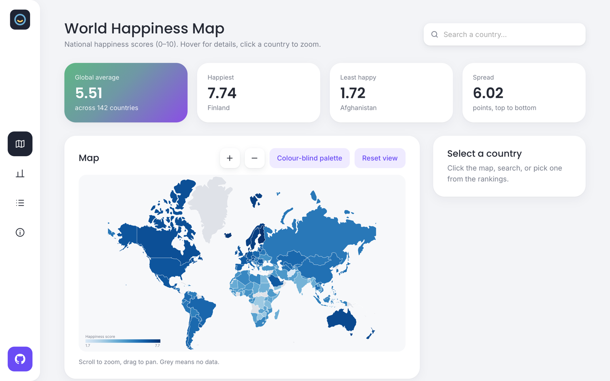

# World Happiness Map

**Live site:** https://itzstephen167.github.io/world-happiness-map/



Interactive Mercator world map built with D3 and TopoJSON (`world-atlas`), colored in shades of blue by happiness score.

Features: hover tooltips, click-to-zoom with a detail card (score + rank), search, pan/zoom controls, top/bottom 10 lists, a regions page with regional averages, dark mode.

## Run locally

The page loads a CSV, so it needs a web server (not `file://`):

```bash
python3 -m http.server 8000
```

Then open http://localhost:8000.

## Deploy to GitHub Pages

1. Push this folder to a GitHub repo.
2. Settings → Pages → Source: "Deploy from a branch", branch `main`, folder `/ (root)`.
3. Your site appears at `https://<user>.github.io/<repo>/`.

## Data

`data/happiness.csv` (`country,score,region`) holds the official World Happiness Report 2025 scores (life evaluations averaged over 2022–2024) with each country's World Happiness Report region, used for the regional averages. `data/happiness_history.csv` (`country,year,score`) has every year from 2011 to 2024 (the report has no 2013 row). Both are built from the report's "Data for Figure 2.1" spreadsheet in `data/raw/`:

```bash
python3 data/build_happiness.py
```

Country names follow common English usage; the few map shapes with different names (e.g. `Macedonia`, `Dem. Rep. Congo`) are renamed in `app.js`.
